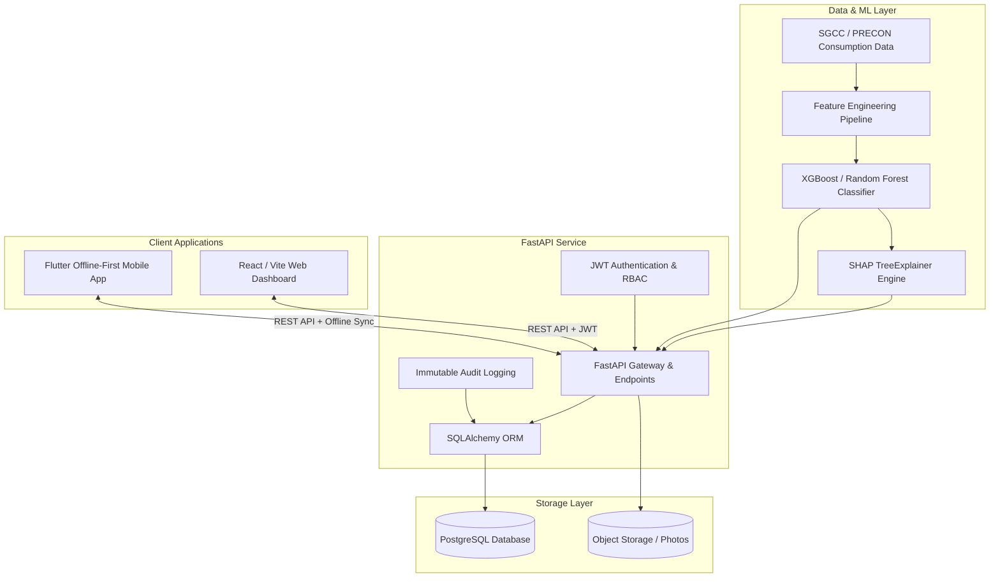

# ⚡ Grid-Guard AI

<div align="center">

[](https://fastapi.tiangolo.com)
[](https://www.python.org/)
[](https://react.dev/)
[](https://flutter.dev/)
[](https://www.postgresql.org/)
[](https://opensource.org/licenses/MIT)

**An Explainable AI (XAI) Revenue Protection Ecosystem for Electricity Theft Detection and Field Inspection Operations.**

[System Overview](#-system-overview) •
[Architecture](#-architecture) •
[Key Features](#-key-features) •
[ML Model Handling](#-ml-model--large-artifacts) •
[Quick Start](#-quick-start) •
[API & Testing](#-testing--api-documentation)

</div>

---

## 📖 System Overview

**Grid-Guard AI** is an end-to-end operational platform engineered for modern power distribution companies (DISCOs). It bridges high-throughput machine learning anomaly detection with real-world field inspection workflows:

1. **AI Anomaly Detection & SHAP Explanations:** Continuously analyzes consumer billing and consumption patterns to score theft risk while providing human-interpretable bilingual (English & Urdu) SHAP explanations.
2. **Revenue Protection Officer (RPO) Console:** A high-density web dashboard built with a custom industrial control-panel aesthetic to prioritize high-risk meters, monitor feeder load distributions, and dispatch field cases.
3. **Offline-First Field Mobile App:** A cross-platform Flutter application enabling field inspectors to review assigned cases, verify meters, capture tamper photos, and log GPS-stamped inspection reports with full offline SQLite caching.

---

## 🏛 Architecture



---

## ✨ Key Features

- **Ranked Risk Queue:** Dynamic prioritization of consumers using composite probability scores (`high`, `medium`, `low`).
- **Bilingual SHAP Explanations:** Automated, plain-language breakdown of anomalies in both English and Urdu (e.g., sudden drop in consumption, abnormal zero-consumption streaks, phase bypass patterns).
- **Interactive Web Dashboard:**
  - **Risk Queue:** Filter by feeder, risk band, and meter type (Single Phase, Three Phase, CT-Metered).
  - **Consumer Detail:** 12-month historical consumption trendline via Recharts, inspector dispatch modal, and bilingual explanations.
  - **Case Management:** Status lifecycle tracking (`assigned` → `in_progress` → `closed_confirmed` / `closed_false_positive` / `closed_inconclusive`).
  - **Model Performance:** Real-time honesty check displaying confirmation rates, false-positive ratios, and 12-week trends.
  - **Feeder Map:** Spatial view mapping flagged meters by feeder distribution.
- **Field Inspector Mobile App (Flutter):**
  - Offline-first architecture backed by local SQLite (`sqflite`).
  - Case syncing when network connectivity is detected.
  - Mandatory evidence collection: GPS location stamping, meter photo upload, and tamper checklists.
- **Enterprise Security & Audit Trail:**
  - Password hashing with Bcrypt.
  - Role-Based Access Control (`officer`, `inspector`, `circle_manager`).
  - Strict audit logging for case creation, assignments, and resolution.

---

## 📦 ML Model & Large Artifacts

### Handling Heavy Files (`> 50MB`)
The trained anomaly detection model (`grid_guard_model.pkl`) is **~56 MB**. 
GitHub has strict policies on file sizes:
- **Warning Threshold:** Any file above **50 MB** triggers a push warning.
- **Hard Limit:** Any file above **100 MB** is strictly rejected.

To keep this repository fast to clone and prevent Git repository bloat, heavy serialized model binaries (`*.pkl`, `*.joblib`, `*.h5`) are excluded in `.gitignore`.

#### Recommended Options to Deploy/Share the Model:
1. **GitHub Releases (Recommended for Demo):**
   - Upload `grid_guard_model.pkl` to this repository's [GitHub Releases](https://github.com/MalaikaAltaf/GridGuard/releases) tag (e.g., `v1.0.0-model`).
   - Download the file and place it inside `backend/ml-artifact/grid_guard_model.pkl`.
2. **Git LFS (Large File Storage):**
   If you wish to version-control the binary directly:
   ```bash
   git lfs install
   git lfs track "backend/ml-artifact/*.pkl"
   git add .gitattributes
   ```
3. **Cloud Storage / Hugging Face Hub:**
   Host the model on Hugging Face Model Hub, AWS S3, or Google Drive, and configure `MODEL_PATH` in `backend/.env`.

---

## 📂 Project Structure

```text
grid-guard-ai/
├── backend/                  # FastAPI Application
│   ├── app/
│   │   ├── auth/             # JWT creation, passwords, dependencies
│   │   ├── ml/               # Feature engineering, inference, scorers
│   │   ├── models/           # SQLAlchemy database entities
│   │   ├── routers/          # API route controllers
│   │   ├── schemas/          # Pydantic request/response schemas
│   │   ├── config.py         # App settings & environment loaders
│   │   ├── database.py       # Engine & SessionLocal setup
│   │   └── main.py           # Application entrypoint & CORS middleware
│   ├── ml-artifact/          # Model binaries (.gitignore) & feature maps
│   ├── tests/                # Automated pytest suite (100+ tests)
│   ├── seed_demo.py          # Demo database seeding script
│   ├── requirements.txt      # Python dependencies
│   └── .env.example          # Environment template
│
├── web/                      # React Admin Web Dashboard
│   ├── src/
│   │   ├── components/       # AppShell, RiskBadge, ProtectedLayout
│   │   ├── context/          # AuthContext (JWT session management)
│   │   ├── pages/            # RiskQueue, ConsumerDetail, CaseList, ModelPerformance, FeederMap
│   │   ├── api.js            # Unified backend fetch layer
│   │   └── index.css         # Skeuomorphic control-panel design system
│   ├── package.json
│   └── vite.config.js
│
├── mobile/                   # Flutter Field Mobile App
│   ├── lib/
│   │   ├── api/              # HTTP client to backend (/cases/mine, /auth/login)
│   │   ├── local_db/         # SQLite storage for offline caching
│   │   ├── models/           # Dart data models
│   │   ├── providers/        # Riverpod state notifiers
│   │   ├── screens/          # Login, MyCases, CaseDetail, InspectionForm
│   │   └── main.dart
│   └── pubspec.yaml
│
├── docs/                     # PRD, Architecture diagrams, UI/UX specifications
├── design/                   # Interactive HTML prototypes & UI design specs
├── .gitignore                # Comprehensive root gitignore (secrets, venv, build)
└── README.md
```

---

## 🚀 Quick Start

### 1. Prerequisites
- **Python:** 3.11+
- **Node.js:** 18+ & npm
- **Flutter SDK:** 3.x (with Android SDK & Emulator for mobile)
- **PostgreSQL Database:** Local instance or cloud hosted (e.g. Supabase, Render, Neon)

---

### 2. Backend Setup

```bash
# 1. Navigate to backend directory
cd backend

# 2. Create and activate a virtual environment
# Windows (PowerShell):
python -m venv venv
.\venv\Scripts\Activate.ps1

# Linux / macOS:
python3 -m venv venv
source venv/bin/activate

# 3. Install dependencies
pip install -r requirements.txt

# 4. Configure environment variables
cp .env.example .env
# Edit .env and supply your DATABASE_URL and JWT_SECRET_KEY

# 5. Populate the database with demo users, consumers, and cases
python seed_demo.py

# 6. Run the FastAPI development server
uvicorn app.main:app --reload --port 8000
```

> **API Documentation:** Once the server is running, explore the interactive Swagger documentation at **http://localhost:8000/docs**.

---

### 3. Web Dashboard Setup

```bash
# 1. Open a new terminal and navigate to web directory
cd web

# 2. Install dependencies
npm install

# 3. Launch Vite development server
npm run dev
```

Visit **http://localhost:5173** (or the port indicated in your console) to view the Web Dashboard.

---

### 4. Mobile App Setup (Android Emulator / Device)

```bash
# 1. Navigate to mobile directory
cd mobile

# 2. Fetch packages
flutter pub get

# 3. Run on connected Android emulator or device
flutter run -d emulator-5554
```

> **Android Emulator Tip:** The app communicates with your backend via `http://10.0.2.2:8000` (the Android emulator alias for `localhost`). Ensure your FastAPI backend is running on port 8000.

---

## 🔑 Demo Credentials

After running `python seed_demo.py`, you can sign in with any of the following accounts:

| Role | Email | Password | Access Surface |
|---|---|---|---|
| **Revenue Protection Officer** | `officer1@gridguard.com` | `Password123!` | Web Dashboard (Full Management) |
| **Field Inspector (Lineman)** | `inspector1@gridguard.com` | `Password123!` | Mobile App & Web (Assigned Cases) |
| **Circle Manager** | `manager1@gridguard.com` | `Password123!` | Web Dashboard (Read-Only Analytics) |

---

## 🧪 Testing & API Documentation

### Run Automated Backend Tests
The backend includes a comprehensive suite of unit and integration tests covering authentication, access control, risk scoring, inspection workflows, and analytics:

```bash
cd backend
pytest -v
```

### Key API Routes
- `POST /auth/login` — Authenticate and receive signed JWT.
- `GET /consumers/risk-queue` — Paginated list of flagged consumers with risk bands.
- `GET /consumers/{id}/explanation` — Retrieve bilingual SHAP feature explanations.
- `GET /consumers/{id}/consumption-history` — 12-month historical consumption data.
- `POST /cases` — Dispatch a consumer investigation to a field inspector.
- `GET /cases/mine` — Inspector-specific case queue for mobile sync.
- `POST /cases/{id}/inspection` — Submit field inspection results with photo & GPS metadata.
- `GET /analytics/model-performance` — Confirmation rates, false positive rates, and weekly trendline.

---

## 🛡 Security & Best Practices

- **Never Commit Secrets:** `.env` files are ignored by default. Use environment variables in production.
- **Role Isolation:** Field inspectors cannot access non-assigned records or administrative configurations.
- **Tamper Evidence:** Mobile uploads capture exact GPS coordinates alongside timestamped inspection photos.

---

## 👩‍💻 Author & Acknowledgements

- **Repository:** [https://github.com/MalaikaAltaf/GridGuard](https://github.com/MalaikaAltaf/GridGuard)
- **Author:** Malaika Altaf
- **License:** MIT License
